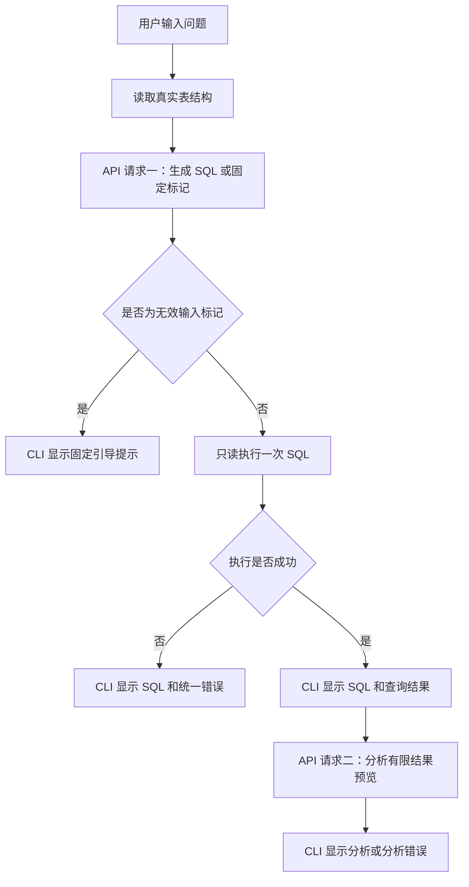

# 项目设计与技术文档

本文集中说明当前系统的设计、源码阅读方式、API 协议、数据库执行与文档评测记录。使用入口见 [README](../README.md)，任务背景、验证效果及汇报提纲见[汇报文档](project-report.md)。本文已同步 2026-11-09 的评测工具移除；历史验证的日期与版本在汇报文档中单独标注。

## 1. 目标与功能范围

系统完成五个步骤：读取数据库上下文并填充提示词；请求模型生成 SQL；执行返回 SQL；请求模型分析执行结果；在 CLI 分别显示 SQL、结果和分析。

查询流程由程序固定控制。有效问题只生成并执行一次 SQL，执行成功后先显示 SQL 和数据，再调用一次分析 API。SQL 失败直接返回错误，分析失败保留查询结果。用户可以继续输入独立问题；项目不包含评测命令，评测结论直接记录在文档。

默认数据库是 Spider 的 `college_2`。SQLite 文件、完整运行数据、JSON 配置示例与依赖源码随仓库提供，Windows/macOS/Linux 构建配置保留。程序采用基础 C++ 写法，通过普通返回值集中报告错误。

## 2. 查询流程与上下文



`run_query` 开始时读取真实表、字段类型、非空约束、主键与外键。生成请求仅包含中文系统提示词、当前问题和数据库结构。标准答案 SQL 和结果行不会放进这次请求。

`run_query` 只负责生成并执行 SQL，不包含分析开关或分析分支。CLI 显示查询结果后单独调用 `analyze_result`，因此分析请求始终在数据展示之后执行。

第二次请求使用独立的分析提示词，上下文包含当前问题、已经执行的 SQL、列名、结果预览及截断标记。两次请求的提示词分别承担“生成 SQL”和“解释真实结果”的职责，避免分析阶段继续只返回 SQL。

每次提问重新建立模型上下文。会话复用数据库连接，但不保留上一题的消息、SQL 或结果作为下一题上下文；涉及“继续筛选”等追问时，应在新问题中写明完整条件。

### 无效输入约定

SQL 系统提示词要求先识别数据查询意图。单独的 help/exit/quit/bye、问候、乱码、写数据库要求以及覆盖系统规则的指令，应只返回 `__INVALID_QUERY__`。`execute_reply` 在执行 SQL 前捕获标记，并显示：

```text
请输入明确的数据库查询问题；查看帮助请输入 /help，退出请输入 /exit。
```

`/help` 和 `/exit` 由 CLI 本地处理；裸 `help`、`exit` 使用模型判定。问题中包含这些词但有明确查询意图时，仍属于有效查询。固定标记分支不执行 SQL、不请求结果分析；输入意图的判断本身仍由模型完成。

### 跨表查看原始记录

分别列出不同表的记录时，每张表输出“表名”和“记录”两列，`json_object` 保存该行的原字段和值，再用 `UNION ALL` 连接。这样既保留来源和重复记录，也满足一条 SQL 的列数要求。例如：

```sql
SELECT 'student' AS "表名",
       json_object('ID', "ID", 'name', "name",
                   'dept_name', "dept_name", 'tot_cred', "tot_cred") AS "记录"
FROM "student"
UNION ALL
SELECT 'instructor',
       json_object('ID', "ID", 'name', "name",
                   'dept_name', "dept_name", 'salary', "salary")
FROM "instructor";
```

单表或关联查询仍按问题要求返回普通列。显示行数和大小上限适用于整条 SQL，跨表查询不会为每张表单独分配显示额度；默认 100 行可能只覆盖整个结果的一部分。

## 3. 代码模块与基础 C++ 写法

| 模块 | 主要职责 |
|---|---|
| [main.cpp](../src/main.cpp) | 程序入口、配置和默认数据定位、Windows 参数转换 |
| [common.cpp](../src/common.cpp) | 普通结果结构体、共用函数、统一错误信息 |
| [config.cpp](../src/config.cpp) | JSON 配置字段、默认值与环境变量 |
| [agent.cpp](../src/agent.cpp) | 系统提示词、标记识别、查询流程与结果分析 |
| [database.cpp](../src/database.cpp) | 只读连接、结构读取、SQL 执行和结果数组 |
| [llm.cpp](../src/llm.cpp) | libcurl HTTPS 请求、响应缓冲区和请求上下文 |
| [json.cpp](../src/json.cpp) | cJSON 操作、字符串转义、请求生成及回复解析 |
| [files.cpp](../src/files.cpp) | 配置文件读取、路径拼接和默认数据路径解析 |
| [cli.cpp](../src/cli.cpp) | 自然语言输入、引导、SQL/结果/分析的显示 |

`main.cpp` 按依赖顺序包含各 CPP，CMake 只编译这个入口。项目没有自写头文件；第三方与系统头文件继续使用。其他功能 CPP 不应再单独加入同一个程序的编译列表，否则会重复定义。

建议先读 `agent.cpp` 的 `run_query`，再看 `cli.cpp` 的输入输出、`database.cpp` 的执行与释放，最后阅读 JSON、HTTP 和文件辅助模块。

自写代码使用普通函数、结构体、字符串、数组、判断、循环和简单指针。变量分别声明，控制语句使用大括号，多层访问拆成局部指针；不定义自写类、模板、Lambda 或异常流程，不使用智能指针、`vector/map/set`、`auto` 或引用参数。标准库内部实现及类型转换、平台条件编译继续保留。

## 4. 结果结构体与指针资源

| 数据 | 内容 | 使用后如何清理 |
|---|---|---|
| `Database` | SQLite 连接和执行选项 | `close_database(&db)` |
| `QueryResult` | SQL、列、行数组、成功及截断状态 | `free_query(&result)` |
| `QueryRun` | 查询结果、无效输入状态和独立分析结果 | `free_query(&run.query)` |
| `Completion` | API 选项与本次 JSON 消息 | `close_completion(&source)` |

`&result` 表示取得结构体地址；函数用 `QueryResult *` 使用同一份数据，`result->row_count` 读取指针所指结构体的字段。行数组按本次行数上限一次分配，每行单元格按实际读取的数据分配，使用 `new (nothrow)` 与 `delete[]`。

```cpp
QueryResult result = execute_sql(&db, "SELECT COUNT(*) FROM student");
if (result.success) {
    QueryRow *row = &result.rows[0];
    Cell *cell = &row->cells[0];
    cout << cell_text(cell);
}
free_query(&result);
```

上例是已有数据库连接中的代码节选。结果数组的释放责任交给调用方；不要把拥有数组的结构体复制到两个位置并分别释放。`free_query` 先释放各行单元格，再释放行数组。`execute_sql` 失败时会清除不完整结果并释放 SQLite statement；调用方仍可统一调用 `free_query`。

cJSON 子对象添加成功后由父对象管理，添加失败由辅助函数释放。请求完成后释放上下文；libcurl 的缓冲区、请求头和连接在同一出口清理。

## 5. JSON 配置与 API 请求

配置包含 `api` 和 `database` 两部分，缺省字段使用结构体默认值。字段只做基本类型与数值范围检查，失败统一返回配置提示。

| 字段 | 默认值 | 作用 |
|---|---|---|
| `api.base_url` | `https://api.deepseek.com` | 请求服务地址，程序追加 `/chat/completions` |
| `api.model` | `deepseek-flash` | 模型名称 |
| `api.api_key` | 空 | 使用者自己的密钥 |
| `api.timeout_seconds` | 45 | 请求总超时，范围 1–600 秒 |
| `api.max_tokens` | 2048 | 回复 token 上限，范围 1–32768 |
| `database.path` | 示例为 `data/college_2.sqlite` | 显式数据库路径；省略时自动定位内置大学库 |
| `database.timeout_ms` | 5000 | SQL 截止时间与忙等待时间 |
| `database.max_display_rows` | 100 | 查询读取行数上限 |
| `database.max_preview_rows` | 100 | 分析请求的行数上限，范围 1–100 |
| `database.max_sql_bytes` | 16384 | SQL 字节数上限 |
| `database.max_result_bytes` | 1048576 | 读取结果内容的估算字节上限 |

数据库路径优先使用 `--db`，再使用配置，最后自动查找程序附带数据。配置相对路径以配置文件所在目录为基准。`DEEPSEEK_API_KEY` 覆盖文件中的密钥，空环境变量也会覆盖。

`model_request_json` 生成 Chat Completions 请求，消息数组包含 system 和 user；两个阶段分别建立消息。请求同时设置 `stream=false`、`temperature=0`、`max_tokens` 和 `thinking.type=disabled`。密钥放在内存中的 `Authorization: Bearer …` 请求头，回复读取第一条 assistant 的 content。

HTTPS 由进程内的 libcurl 发送，校验证书与主机名，不跟随重定向，忽略 netrc。连接超时为 10 秒，总超时由配置指定；解压后的响应最多 2 MiB，请求 JSON 最多 512 KiB，支持取消回调。URL、模型名等不再做逐项业务预校验，请求和回复失败统一报告 API 错误。

分析数据默认最多 100 行、128 KiB，列名最多 128 字节、单值最多 2048 字节，长文本按 UTF-8 字符边界裁剪。数据用 JSON 的列名数组和行数组按位置对应，保留重名列及数值、文本、NULL 的区别；元数据说明本地读取行数、实际发送行数和完整性。原查询截断、行数受限或长值被裁剪时，模型会注明限制；完整结果可直接汇总。详情类问题按主体归并重复信息并列出必要明细，区分不同课程数量与选课记录数量，不把 `LIMIT 1` 选出的对象视为唯一第一。

## 6. SQLite 执行与集中错误处理

用户数据库通过 `SQLITE_OPEN_READONLY` 打开。执行层保留 `query_only`、defensive、`trusted_schema=OFF`、authorizer、语句只读检查和函数白名单；编译时关闭扩展加载。写操作、DDL、ATTACH、事务和模型 PRAGMA 被拒绝，合法 JOIN、CTE、聚合与窗口函数可以使用。

内部结构读取使用固定查询与转义后的真实表名，临时允许所需的内部操作，然后恢复授权检查。模型 SQL 只允许一条；剩余文本若能准备出第二条 statement，会被拒绝。

SQL 长度、列数、表达式等受 SQLite limit 控制。默认 SQL 16 KiB、最多 128 列、单值最多 1 MiB；执行与逐行读取同时检查截止时间和取消状态。达到行数或结果内容上限时保留已读取数据并标记截断，执行错误时清除不完整行。

SQLite 结果保留整数、浮点数、文本、NULL 和 BLOB 类型；BLOB 显示为十六进制。终端为可读性裁剪长文本，分析预览有独立上限。

错误文案集中在 `common.cpp` 的 `error_message`。各模块记录成功或失败，统一清理后返回类别提示；CLI 负责显示。保留 API、配置、文件、数据库、SQL、参数和取消等少量类别，不展开传输错误码或字段级诊断。分析状态与查询状态独立，分析错误不会抹掉 SQL 和查询结果。

## 7. 文档评测记录

项目已移除 `benchmark.cpp`、评测命令、CSV 输出、数据集加载和自动结果比较。已有验证结果保存在[汇报文档第 4.4 节](project-report.md#44-功能验证与评价范围)，并注明历史记录与当前验证的区别。

新增评测按以下步骤人工记录：

1. 选定问题和已有 SQLite 文件，用 `--db` 启动查询，记录模型生成的 SQL、实际数据和分析。
2. 在本地数据库客户端以只读方式执行标准 SQL，核对返回列、每个值、重复行次数及排序；标准 SQL 不发送给模型。
3. 整数按原值核对；浮点结果说明误差口径。遇到截断、标准 SQL 失败或无法核对时，记录“无法比较”及原因。
4. 在汇报文档写明日期、源码版本、平台、模型、相关配置、问题、数据库、标准与预测 SQL、预期和实际结果、是否一致，以及分析文字是否忠实。

原有两道中文题保存在 `data/sample-spider/dev.json`，可作为手工核对样例。大学库支持计数、分组、JOIN 和排名等验证。若记录多题比例，应同时写明尝试题数、执行成功数、可比较数和一致数；模型失败与无法比较都要保留，不能只汇总成功题。

文档中的两题历史结果只说明当时样例流程可用，不能代表完整 Spider 准确率，也不能代替对当前版本重新查询的结果。当前没有完整 dev 集评测结论；单库实例上的结果一致不等于跨数据实例的 SQL 语义等价。

## 8. 仓库数据与来源

| 仓库内容 | 用途 |
|---|---|
| [college_2.sqlite](../data/college_2.sqlite) | 默认大学数据库，11 张表、34620 条表记录合计，来自 Spider，原字节保留 |
| [company.sqlite](../data/company.sqlite) | 3 个部门、6 名员工的小型样例 |
| [sample-spider/dev.json](../data/sample-spider/dev.json) | 两道中文回归题及对应 company 数据库 |
| [spider.zip](../data/spider.zip) | 原样保留的 206 个不重复数据库、题目、表元信息与标准 SQL，按需手动解压 |
| [spider-manifest.json](../data/spider-manifest.json) | 运行包文件大小、SHA-256 与划分题数 |
| [SHA256SUMS](../data/SHA256SUMS) | 直接随仓库提供的数据文件校验值 |

`college_2.sqlite` 为 2117632 字节，历史数据整理时确认与 ZIP 中原数据库字节一致。完整 ZIP 为约 57 MiB 的普通 Git 文件，仍随 clone 提供。CMake 只复制现成的 college_2、company 和小型样例到构建数据目录，不读取 ZIP、不自动解压或校验，也不提供安装目标。

默认启动不依赖 ZIP 的解压结果。其他 Spider 数据库需要用户手动解压，并通过 `--db` 指向其中具体的 `.sqlite` 文件；Windows 可以使用资源管理器“全部提取”。原 SHA256SUMS 与 manifest 仅作为历史数据清单保留，程序不执行归档校验。

| 运行包划分 | 题数 | 数据库数 |
|---|---:|---:|
| dev | 1034 | 20 |
| train_spider | 7000 | 140 |
| train_others | 1659 | 6 |
| test | 2147 | 40 |

运行包来源于 [Spider 官方数据](https://yale-lily.github.io/spider)。原下载包的重复数据库副本合并到统一 `database/`，题目、数据库、元信息及标准答案保留原始字节；上游 README 和引用说明保存在 ZIP 内。项目许可证不替代上游数据说明。

## 9. 依赖、跨平台与构建

| 依赖 | 来源与许可 | 集成方式 |
|---|---|---|
| SQLite 3.50.4 | [官方 amalgamation](https://sqlite.org/2025/sqlite-amalgamation-3500400.zip)，公有领域 | 固定 C 源码；`SQLITE_OMIT_LOAD_EXTENSION`、`SQLITE_DQS=0` |
| cJSON 1.7.19 | [版本源码](https://github.com/DaveGamble/cJSON/tree/v1.7.19)，[MIT](../third_party/cjson/LICENSE) | 固定 C 接口，JSON 库调用集中在辅助模块 |
| libcurl ≥ 7.68 | 系统或包管理器，[curl license](https://curl.se/docs/copyright.html) | CMake `find_package(CURL)` 链接；Windows 推荐静态 vcpkg curl |

第三方源码校验值在 [third_party/SHA256SUMS](../third_party/SHA256SUMS)。CMake 不在线下载 SQLite 或 cJSON；开发环境需要事先安装 libcurl 和编译工具。

Windows 将原生 UTF-16 命令行转换为 UTF-8，并设置 UTF-8 控制台。业务路径用普通字符串，文件系统接口集中在 `files.cpp`，SQLite 接收 UTF-8 路径。CMake 保留 MSVC、Shell32、vcpkg 静态 curl 与静态运行库设置；入口兼容多配置构建目录和程序旁边的 data 目录。

[CI 配置](../.github/workflows/ci.yml) 定义 Linux、macOS 和 Windows 的编译及启动帮助检查。当前实际验证记录来自 macOS；三平台配置的存在与本版本的跨平台运行结果应分别理解。

源码外构建可启用 `TEXT2SQL_SANITIZERS=ON` 辅助检查内存和未定义行为。项目不保留测试目录，开发检查在临时目录中进行。构建、数据目录和文档评测记录的使用方式统一见 [README](../README.md)。
